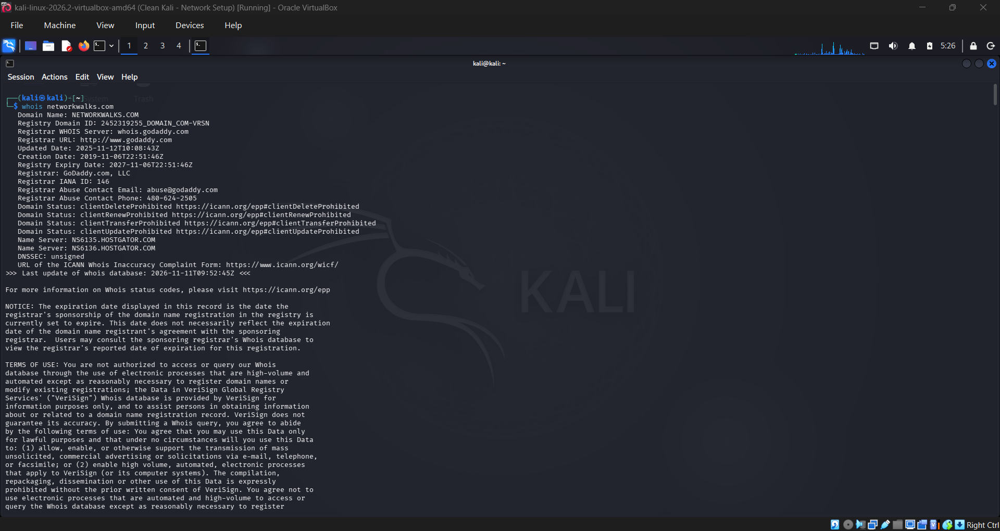

# PENETRATION-TESTING-REPORT
 Footprinting &amp; Network Scanning Phases 

**W2-PM-FINAL  |  CYBERSECURITY  |  NETWORKWALKS**
| Field | Detail |
|---|---|
| **Pentester Name (Cybersecurity Professional)** | **** |
| **Program/Batch** | B082-Networkwalks |
| **Date** | 13 November 2026 |
| **Modules completed** | W2-PM1 (Multiple Kali Tools)<br>W2-PM5 (Zenmap Scanning) |
| **Client/Target** | 1. Networkwalks (secured written permission already)<br>2. My own local LAN Network |
| **Permission secured from client?** | Yes |
| **Phases covered** | **Phase 1:** Reconnaissance & Footprinting<br>**Phase 2:** Scanning & Network Discovery<br>**Phase 3-5:** In Progress |


# 1. Introduction

This report covers footprinting the networkwalks.com domain using multiple Kali Linux tools (W2-PM1) and **scanning my own local network with Zenmap** (W2-PM5).

One module covers the **footprinting phase** and the other covers the **scanning phase**, so together they show **how an attacker moves from gathering public information to mapping live hosts on a network**.

It is the Week 2 part of my ongoing internship program at Networkwalks.

**All commands were run in Kali Linux (footprinting) and on a Windows PC with Zenmap installed (scanning)**. 

Every step below includes the exact command used, the result I observed, **a screenshot as evidence**, and **a short note on why the finding matters from an attacker's point of view**.

# 2. Tools Used

The table below lists each tool used in this report and its purpose.

| Tool | Purpose |
|---|---|
| Kali Linux & Windows | Operating systems used for reconnaissance activities             |
| WHOIS                | Find domain registration details (owner, dates, name servers).   |
| whatweb              | Fingerprint web technologies (server, CMS, plugins, IP).         |
| nslookup             | Resolve the domain name to its IP address using DNS.             |
| curl -I              | Read the HTTP response headers of the website.                   |
| wafw00f              | Detect whether a Web Application Firewall protects the site.     |
| dnsrecon             | Enumerate all DNS records (NS, MX, SPF, TXT, SRV).               |
| Zenmap (Nmap GUI)    | Scan the local subnet to find live hosts, IPs and MAC addresses. |
| Windows CMD          | Local IP and MAC address identification                          |


# 3. Activities Performed

## 3.1 Footprinting & Reconnaissance

I performed reconnaissance against the **`networkwalks.com` domain** using six Kali Linux tools: ```whois```, ```whatweb```, ```nslookup```, ```curl```, ```wafw00f``` and ```dnsrecon```. Each tool was used to collect a different type of information about the target.

## Task 1 
First, I used ```whois``` to obtain publicly available domain registration information and identify the domain’s name servers. The results provided information about the domain registration and hosting infrastructure.
```
whois networkwalks.com
```


## Task 2
I then used ```whatweb``` to identify technologies used by the website. The results identified **WordPress 7.0.4** and **WP Download Manager 3.3.58**, along with other information exposed by the website.

```
whatweb networkwalks.com
```


## Task 3
Using ```nslookup``` I resolved the domain name to its IP address. The provided result identified **192.232.216.135**.
```
nslookup networkwalks.com
```


## Task 4
I used ```curl``` with the `-I` option to inspect the HTTP response headers. This provided additional information about the web application and exposed the WordPress REST API endpoint `/wp-json/`.
```
curl -I https://networkwalks.com
```


## Task 5
Next, I used ```wafw00f``` to determine whether a Web Application Firewall was protecting the website. The result identified **ModSecurity (SpiderLabs)**.
```
wafw00f networkwalks.com
```


## Task 6
Finally, I used ```dnsrecon``` to enumerate DNS records. The results provided information relating to name servers, mail servers, SPF/TXT records, service records and DNS software information.
```
dnsrecon -d networkwalks.com
```


## 4.2 Network Scanning with Zenmap

For the second activity, I used **Zenmap** to perform network discovery on my local network. The practical required me to identify my local IP address and subnet, discover live hosts, identify their IP and MAC addresses, and generate a network topology.

## Task 1
I first used the Windows `ipconfig` command to identify my local IP address and LAN subnet.
```
ipconfig
```
## Task 2
I then entered the subnet into Zenmap and selected **Ping Scan** to identify active hosts.


## Task 3
After completing the scan, I opened the **Topology** section in Zenmap, enabled the legend and saved the network topology in PDF format as required by the practical task.


# 5. Conclusion

During Week 2 of my Cybersecurity & Ethical Hacking internship, I completed practical activities covering **footprinting**, **reconnaissance and network scanning**.

In the footprinting activity, I used six Kali Linux tools to collect information about the target domain. I learned how ```whois``` can provide domain information, ```whatWeb``` can identify web technologies, ```nslookup``` can resolve domain names, ```curl``` can inspect HTTP headers, ```wafw00f``` can identify a WAF, and ```dnsrecon``` can provide additional DNS information.

In the network scanning activity, I used Zenmap to identify my local network configuration and discover active hosts. I also collected IP and MAC address information and created a network topology.

The exercises showed me that **information gathering is an important part of cybersecurity**. Even before attempting to exploit a system, a security professional can learn a significant amount about an environment by carefully analyzing publicly available information and network responses.

I also learned that **technical findings should be documented clearly**. A good cybersecurity report should explain **what was performed**, **what was discovered**, **what the observation means**, **what risk it may create**, and **what can be done to reduce that risk**.

Finally, I learned that **reconnaissance and scanning** must always be performed within an authorized scope. These activities were completed as part of the assigned educational cybersecurity lab.


